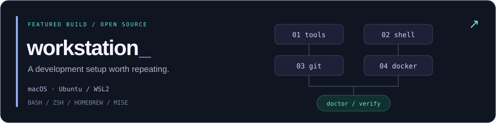

<p align="center">
  <picture>
    <source media="(prefers-color-scheme: dark)" srcset="./assets/neofetch-dark.svg" />
    
  </picture>
</p>

<p align="center">
  <a href="https://www.linkedin.com/in/minhlu"><b>LinkedIn</b></a>
  &nbsp; / &nbsp;
  <a href="https://github.com/minhlu-i?tab=repositories"><b>Projects</b></a>
  &nbsp; / &nbsp;
  <a href="https://www.facebook.com/minhlu99"><b>Facebook</b></a>
</p>

<br />

## Behind the build

I'm Minh, a backend developer who likes understanding how the pieces fit together: the API, the database, the infrastructure, and the tools that make building them feel good.

My current playground spans **backend development**, **developer tooling**, and **AI-assisted coding workflows**. I build things to use them—and sometimes rebuild them to understand them.

```text
minh@workstation ~ % cat focus.txt

BUILD     Backend services · repeatable development environments
TOOL      Bash / Zsh · Docker · Codex / Claude Code
EXPLORE   System design · solution architecture · gamification
```

<br />

## On my workbench

<a href="https://github.com/minhlu-i/workstation">
  
</a>

### [workstation ↗](https://github.com/minhlu-i/workstation)

**Less setup friction. More time building.**

A modular development workstation setup for **macOS and Ubuntu / WSL2**, with a bootstrap entry point, focused installers, and a doctor command that checks the implemented setup domains.

- **Tools that work together.** Homebrew + mise, common CLI tools, and Codex / Claude Code installation.
- **A shell that feels like home.** Native Zsh on macOS, Bash on Ubuntu / WSL2, with Starship and zoxide.
- **The everyday essentials.** Git configuration and Docker tooling through OrbStack or native Docker Engine.
- **Check before changing.** Reuse working tools, preserve configuration backups, and verify the result.

<sub>Implemented: tools, shell, Git, Docker, and doctor checks. Workspace organization is planned.</sub>

<br />

## The things I gravitate toward

| Backend engineering | Developer experience | Systems thinking |
| :--- | :--- | :--- |
| Building web backends with TypeScript, NestJS, and PostgreSQL. | Turning repeated setup steps into scripts and bringing AI coding tools into the workflow. | Learning system design, solution architecture, and how gamification shapes a product. |

<br />

## Tools of the trade

<p>
  
  
  
  
  
  
</p>

<br />

---

<p align="center">
  <b>“Don't reinvent the wheel, unless you plan on learning more about wheels.”</b>
  <br /><br />
  <sub>Have something interesting to build? <a href="https://www.linkedin.com/in/minhlu">Let's talk.</a></sub>
</p>
